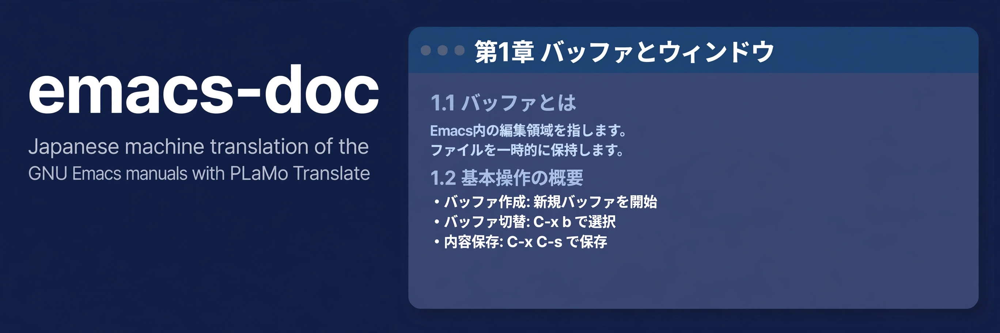

<p align="center">
  
</p>

<p align="center"><strong>The GNU Emacs manuals in Japanese, translated with PLaMo Translate</strong></p>

<p align="center">
  <a href="https://github.com/conao3/emacs-doc/actions/workflows/ci.yml"></a>
  <a href="https://github.com/conao3/emacs-doc/actions/workflows/update.yml"></a>
  <a href="https://emacs-doc.conao3.com"></a>
  <a href="#license"></a>
  <a href="https://github.com/conao3/emacs-doc/stargazers"></a>
</p>

<p align="center">
  <a href="https://emacs-doc.conao3.com">Site</a> ·
  <a href="#manuals">Manuals</a> ·
  <a href="#how-it-works">How it works</a> ·
  <a href="#correcting-a-translation">Correcting a translation</a> ·
  <a href="#development">Development</a> ·
  <a href="#license">License</a>
</p>

# emacs-doc

emacs-doc machine-translates the GNU Emacs manuals into Japanese with [PLaMo Translate](https://translate.preferredai.jp/) and serves them at <https://emacs-doc.conao3.com>. Each page links to the original page on gnu.org.

This is a personal project and is not affiliated with the Free Software Foundation, the GNU Project, or Preferred Networks.

## Manuals

| Manual | Per node | One page | Source |
|---|---|---|---|
| GNU Emacs Manual | [`emacs/`](https://emacs-doc.conao3.com/emacs/) | [`mono/emacs.html`](https://emacs-doc.conao3.com/mono/emacs) | `doc/emacs/emacs.texi` |
| GNU Emacs Lisp Reference Manual | [`elisp/`](https://emacs-doc.conao3.com/elisp/) | [`mono/elisp.html`](https://emacs-doc.conao3.com/mono/elisp) | `doc/lispref/elisp.texi` |
| An Introduction to Programming in Emacs Lisp | [`eintr/`](https://emacs-doc.conao3.com/eintr/) | [`mono/eintr.html`](https://emacs-doc.conao3.com/mono/eintr) | `doc/lispintro/emacs-lisp-intro.texi` |

The manuals follow the master branch of [Emacs](https://github.com/emacs-mirror/emacs). `EMACS_REVISION` records the commit the translations were last merged with.

## How it works

1. `make fetch-latest` checks out the `doc` directory and `configure.ac` of the Emacs master branch and writes its commit to `EMACS_REVISION`. `make fetch` checks out the commit already in `EMACS_REVISION`.
2. `make html` builds each manual with `makeinfo --html` twice: one page per node in `<manual>/`, and the whole manual in one page in `mono/<manual>.html`.
3. `make pot` extracts the text of every page with po4a (`xhtml`) into one catalog per manual and merges it into `po/<manual>.ja.po` with `msgmerge --previous`. Both versions of a manual share the catalog; a paragraph whose links differ between them (`Node.html` and `#Node`) is a separate entry. A paragraph whose English changed becomes fuzzy; a new paragraph is untranslated.
4. `make translate` fills the untranslated and fuzzy machine-translated entries with [plamo-tr-po](https://github.com/conao3/rust-plamo-tr-po). Code (`code`, `kbd`, `pre`, `samp`, `var`) stays in English, and plamo-tr-po skips entries extracted from `pre`, `style`, and `script`. `LIMIT=<n>` stops after n msgids.
5. `make site` writes the translated pages to `dist/` with `po4a --keep 0`, so a paragraph without a translation stays in English. Each page gets a notice that links to the original page on gnu.org (`html_node` or `html_mono`).
6. `make package` packs `dist/` into `build/dist.tar.zst` (the same files give the same archive) and writes its SHA-256 to `SITE_SHA256`.
7. `make fetch-site` downloads `dist.tar.zst` from the release `site`, checks it against `SITE_SHA256`, and unpacks it into `dist/`. `make deploy` uploads `dist/` to the Cloudflare Worker `emacs-doc` (static assets) with wrangler.

`make stats` prints the translated and untranslated counts of each catalog.

### Updates and deployment

You run the `Update` workflow by hand (`gh workflow run update.yml`). It runs `make fetch-latest pot site stats package`, uploads `build/dist.tar.zst` to the release `site`, and commits `EMACS_REVISION`, `SITE_SHA256`, and the updated `po/*.ja.po`. A new or changed paragraph stays in English until you run `make translate` locally, push the catalogs, and run `Update` again.

Workers Builds deploys the Worker on every push to `master` with the build command `make fetch-site` and the deploy command `npx wrangler deploy`, so the repository holds no Cloudflare credentials. If a push carries a `SITE_SHA256` that does not match the archive in the release, the build fails and the deployed site stays as it is.

## Correcting a translation

Edit the `msgstr` in `po/<manual>.ja.po` and delete the line `# Machine-translated by PLaMo Translate.` of that entry. plamo-tr-po does not overwrite entries without that line, and it leaves a fuzzy entry without that line for a person to review.

## Development

```console
$ nix develop
$ make fetch site
$ make check
```

`make check` runs `nix fmt -- --ci`, shellcheck on `scripts/`, and `msgfmt --check-format` on the catalogs.

## License

The manuals and their translations (`po/`, and the generated site) are distributed under the GNU Free Documentation License, version 1.3 or later (`COPYING.FDL`), the same license as the original manuals. The scripts and configuration are Apache-2.0 (`LICENSE`).
